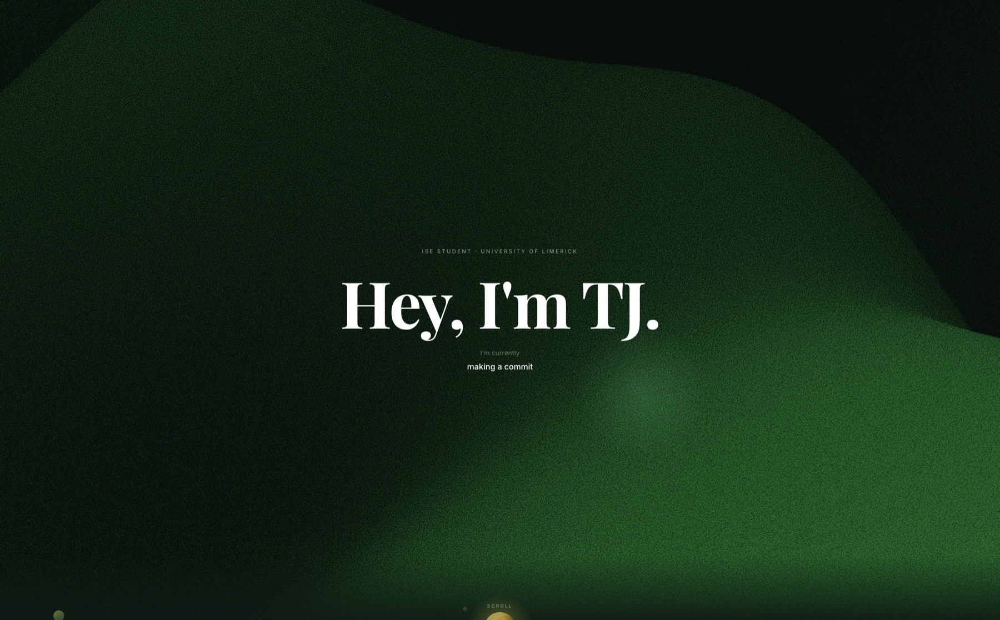

# Tazo's Website
<p align="center">
  
</p>


My personal website. It follows my journey from secondary school to where I am now, and covers
who I am, the projects I've built, and where to find me online.

**Live:** [tazo-web.vercel.app](https://tazo-web.vercel.app)

## What's on it

- **Journey**: a scroll-driven timeline, from Castletroy College through my years studying
  Immersive Software Engineering at the University of Limerick and my residencies at Analog
  Devices and Avtrain
- **About**: a bit about me and the tools I work with
- **Projects**: things I've built, with screenshots and write-ups
- **Socials**: my handles

## Built with

Next.js, TypeScript, Tailwind CSS, Framer Motion, ShaderGradient (React Three Fiber) and Lenis.

## Running it locally

```bash
npm install
npm run dev
```
